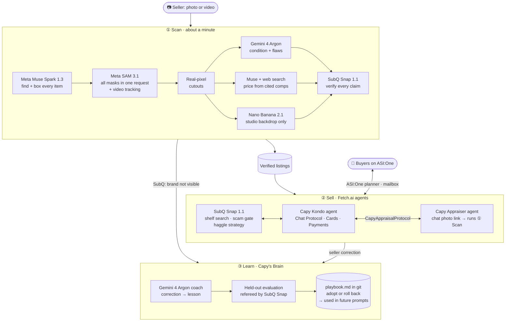

# Capy Kondo 🍊: make room for what matters


Most people have a closet full of things worth selling, but photographing, pricing, describing and haggling over each one is such a chore that it all stays in a box. **Capy Kondo turns one photo or a 6-second video of the whole pile into honest, priced listings in about a minute:** Meta Muse Spark and SAM 3.1 find and cut out every item, Gemini 4 Argon grades its condition, and SubQ Snap checks every claim against the real photo. A Fetch.ai agent then sells everything for you on ASI:One, where buyers search, haggle and pay right in chat. Every correction becomes a lesson that is kept only if it improves results on examples it has never seen, so Capy gets better with every sale.

<p align="center"></p>

**▶ Demo video (2 min):** [YouTube](https://www.youtube.com/watch?v=ycgpqoeGFeo) · [mp4 in this repo](docs/capykondo_demo.mp4)  
**Try the agent:** [Capy Kondo on Agentverse](https://agentverse.ai/agents/details/agent1qtzxcaqfx88j4l0078ktkeat7lka3z9gvg7n0al4u6245zf9727xqgd3sj2/profile),
or ask ASI:One to *"find a marketplace agent that sells decluttered secondhand items"*.

## Sponsors at a glance

| Sponsor | What we used | What it does in Capy Kondo |
|---|---|---|
| **Meta** | Muse Spark 1.3 (with web search) · SAM 3.1 | Finds and boxes every item, reads price stickers, cuts all items out in one request (and tracks them through video), and prices each one from live, cited comparable listings |
| **Google** | Gemini 4 Argon · Nano Banana 2.1 | Grades condition and lists flaws, coaches the self-improvement loop, and paints empty studio backdrops (the item's pixels stay real) |
| **Subquadratic** | SubQ Snap 1.1 Decisions API | Calibrated probabilities that the code acts on: verifies every listing claim, ranks the whole shelf for a buyer, blocks scams, picks the haggling strategy and referees the evaluations |
| **Fetch.ai** | uAgents · Agentverse · ASI:One (Chat Protocol, Interactive Cards, Payment Protocol, ASI:One LLM) | Two agents on Agentverse: **Capy Kondo** (the shop, found by ASI:One's planner) and **Capy Appraiser** (photo in, listings out), talking over our own agent-to-agent protocol. Buyers search, haggle and pay inside ASI:One |

## Architecture



The scan runs as a pipeline: once Muse and SAM are done, pricing, inspection, backdrops and verification run in
parallel for each item. A table of 6–8 items is fully listed in about a minute (40–80 s measured). Muse returns the
items in about 10–25 s, and SAM masks all of them a few seconds later.

## How each sponsor powers it

### Meta: Muse Spark 1.3 and SAM 3.1

- **Find (Muse Spark 1.3).** One call with a strict JSON schema returns every sellable item with a box, a name, a
  category and any visible price sticker. In photo mode the seller's own sticker price beats the model's estimate. In
  video mode Muse also returns the moment each item is clearest. (`capykondo/pipeline.py`)
- **Cut out (SAM 3.1).** All of Muse's boxes go to SAM 3.1 in a single object-prompt request (16 objects per request),
  with a text-concept fallback. In video mode the clip is uploaded once through the Files API and every item is
  tracked across frames: concept tracks are ranked by how close they are to Muse's box, duplicates are removed by
  overlap, and the frame with the largest mask is used. The masks drive the live outline overlay and become cutouts of
  the item's real camera pixels. (`capykondo/segment.py`)
- **Price (Muse Spark 1.3 + web search).** Each item is identified and priced from live comparable listings. The
  cited URLs ship with the listing as evidence. If SubQ can't confirm a brand, the item is re-priced as unbranded.
- **Talk.** Inside the agent, Muse classifies what the buyer wants and writes the counter-offer messages, with minimal
  reasoning effort for speed.

### Google: Gemini 4 Argon and Nano Banana 2.1

- **Inspect (Gemini 4 Argon).** Gives a condition grade (new, like new, good, fair, poor) and a list of visible flaws
  from one or more views of the item. In video mode those are several frames of the same tracked item. Output is
  structured JSON through the Interactions API, with a set thinking level.
- **Coach (Gemini 4 Argon).** In Capy's Brain, Argon turns a single correction into one general, reusable lesson, for
  example *"Default to 'Unbranded' when an item shares a common generic shape with a well-known brand but lacks any
  visible logos or markings."* (`capykondo/brain.py`)
- **Studio (Nano Banana 2.1).** Generates an empty studio surface that suits the item's category. The item's real
  SAM-cut pixels are composited on top with soft shadows. The model never repaints the item, so listing photos stay
  honest. Backdrops are cached. (`capykondo/studio.py`)
- **Mascots.** The capybara mascot set was generated with Nano Banana 2.1 and cut out with SAM 3.1.
  (`scripts/make_mascots.py`)

### Subquadratic: SubQ Snap 1.1

SubQ Snap answers yes/no, multiple-choice and score questions with calibrated probabilities in about 0.3–0.8 s.
Capy Kondo's code acts on those numbers instead of on generated text, at five decision points
(`capykondo/subq.py`):

| Decision | Input | What the code does with it |
|---|---|---|
| **Trust check** | the listing's claims + up to 4 photos | Brand visible < 0.35 → brand removed, item re-priced, lesson learned automatically. Photo mismatch → seller review. Prohibited item → blocked |
| **Shelf search** | the buyer's words + the whole catalog in one long-context call | *"something to keep my drinks cold"* → the water bottle (items scoring ≥ 0.5) |
| **Scam gate** | every buyer message + the conversation | Gift cards, verification codes or off-platform payment → polite refusal (scam ≥ 0.6) |
| **Haggle strategy** | listing, offer, round, history | Accept, meet in the middle, hold firm, or final offer. The seller's floor price is enforced in code |
| **Eval referee** | the Brain's identification answers, in one batched call | Decides whether each answer matches the ground truth |

From the demo: Muse called the keyboard a *"ZIYOU LANG RK-T8"*. SubQ scored the brand as visible at **0.06** (photo
match 0.997), so it was listed honestly as a *"Gray and orange mechanical keyboard"* and the Brain learned from it.

### Fetch.ai: uAgents, Agentverse and ASI:One

| Agent | Address | What it does |
|---|---|---|
| **Capy Kondo** (`capy-kondo`) | `agent1qtzxcaqfx88j4l0078ktkeat7lka3z9gvg7n0al4u6245zf9727xqgd3sj2` | Marketplace agent for buyers and sellers: search, item details with evidence, haggling, payment, seller corrections, *"what have you learned?"* |
| **Capy Appraiser** (`capy-appraiser`) | `agent1qgc834a4yf39tcshhupmxsft9vlw9mnanqyfdrwh5xqe5t8j2tvajuz8alk` | Specialist: photo or video link in, priced and verified listings out. Capy Kondo hands work to it agent-to-agent |

- **Agent Chat Protocol with ASI:One Interactive Cards.** Carousels of items; detail cards with evidence (real photo,
  flaws, comps, SubQ verification); an offer form; counter-offer and purchase review cards; receipts.
- **Agent Payment Protocol (seller role)** with Stripe Checkout in test mode: `RequestPayment` → `CommitPayment` →
  `CompletePayment`. Without Stripe keys, purchases run in a clearly labelled demo mode.
- **Multi-agent.** Our own `CapyAppraisalProtocol` (`AppraiseRequest` / `AppraiseResult`) connects the two agents:
  *"I want to sell my stuff: \<photo link\>"* goes from Capy Kondo to Capy Appraiser, which runs the full pipeline.
- **Discoverable.** Both agents are mailbox agents on Agentverse with published protocol manifests, READMEs and
  avatars. **ASI:One LLM** (`asi1-mini`) handles small talk.
- **Verified end to end on ASI:One.** From a plain request (*"find a marketplace agent that sells decluttered
  secondhand items"*), ASI:One's planner found `capy-kondo` on Agentverse and messaged it through its mailbox. It
  showed the SubQ-ranked listings and detail cards, and relayed a counter-offer card for the buyer to accept.
- **Business model.** A per-sale fee through the Payment Protocol, plus a monthly plan for shops and resellers. Every
  sale is an agent-to-agent transaction on Fetch.ai's rails.

Try it on ASI:One: *"Any headphones under $30?"*, *"Would you take $15 for the keyboard?"*,
*"I want to sell my stuff: \<photo link\>"*, *"The mug should be $5"*, *"What have you learned?"*

## Capy's Brain: it gets better, and it can roll itself back

1. Every correction becomes an evaluation case. Corrections come from the seller (*"the mug should be $5"*) or
   automatically from SubQ (*a brand was claimed, but no logo is visible*).
2. **Gemini 4 Argon** turns the correction into one general lesson.
3. The lesson is scored **with vs. without** on the corrected case plus held-out cases it has never seen (earlier
   corrections and a 21-case starter benchmark). Identification answers are refereed by SubQ Snap; prices and grades
   are scored by rules.
4. A lesson is **adopted only if it fixes the corrected case with zero held-out regressions**; otherwise it is
   **rolled back**. Every decision is a git commit in `data/brain` (`playbook.md`, `history.md`), and adopted lessons
   go into future prompts.

Real decisions from the demo run:

| Lesson written by Gemini 4 Argon | Held-out score | Decision |
|---|---|---|
| Default to "Unbranded" when an item has a common generic shape but no visible logos | 78% → 100% | ✅ adopted (v1) |
| Don't assign a major electronics brand when the usual logo surfaces are visible and blank | 100% → 100% | ✅ adopted (v2) |
| Don't infer a white-label brand from color schemes or layouts alone | 100% → 100% | ✅ adopted (v3) |
| "Price plush toys around $30 as rare collectibles" (a bad seller correction) | 75% → 62% | ↩️ rolled back |
| "Price plush toys around $35 as rare collectibles" | 67% → 56% | ↩️ rolled back |

## Run it

Needs [uv](https://docs.astral.sh/uv/) and `ffmpeg` (`brew install uv ffmpeg`, or `apt install ffmpeg` +
`curl -LsSf https://astral.sh/uv/install.sh | sh`). uv fetches Python 3.13 and the locked dependencies itself.

```bash
uv sync                      # .venv from pyproject.toml + uv.lock
cp .env.example .env         # fill in keys (see below)
uv run python -m capykondo   # web app on http://localhost:8787 + both Fetch.ai agents
```

`.env` keys:

| Key | Needed for |
|---|---|
| `MODEL_API_KEY` | Meta Model API (Muse Spark, SAM 3.1) |
| `GEMINI_API_KEY` | Gemini 4 Argon, Nano Banana 2.1 |
| `SUBQ_API_KEY` | SubQ Snap 1.1 decisions |
| `ASI1_API_KEY` | ASI:One LLM (optional) |
| `BROKER_SEED`, `APPRAISER_SEED` | Agent identities. Keep the same values to keep the same agent addresses |
| `AGENTVERSE_API_KEY` | Optional: connects both agent mailboxes to Agentverse automatically at startup |
| `STRIPE_SECRET_KEY`, `STRIPE_PUBLISHABLE_KEY` | Optional: Stripe test-mode payments (`sk_test_…`/`pk_test_…`) |
| `PUBLIC_BASE_URL` | Optional: public HTTPS URL of this server, for item photos inside ASI:One cards and phone-camera access |

**Connect the agents to Agentverse** (once): either set `AGENTVERSE_API_KEY`, or open the two inspector links printed
at startup (also shown in the app's sidebar) and click **Connect → Mailbox**. Then search for *Capy Kondo* on ASI:One,
or open the agent's Agentverse profile and chat with it.

**Public URL** (so ASI:One can show item photos, and so a phone can use its camera on the scan page):

```bash
cloudflared tunnel --url http://localhost:8787
```

Put the printed `https://….trycloudflare.com` into `PUBLIC_BASE_URL` and restart.

### Live demo tips
- `http://localhost:8787`: scan anything with **Start camera → Snap photo** (or **Scan 6s video**), or use the samples.
- Click any card for the evidence drawer: real photo, flaws, SubQ verification, comps. Use **Fix this listing** to
  teach Capy, and watch **Capy's Brain** adopt or roll back the lesson.
- `uv run python scripts/scan_cli.py photo.jpg` runs a scan from the terminal; `uv run python scripts/test_broker.py`
  runs a scripted buyer.

### Re-make the demo video
With the app running (and `ELEVENLABS_API_KEY` in `.env`), record the scenes with Playwright via **pnpm**, then
assemble narration, music and captions:

```bash
cd demo && pnpm install && pnpm exec playwright install chromium
pnpm record                          # scenes -> demo/build/raw
cd .. && uv run python demo/make_video.py   # -> demo/build/capykondo_demo.mp4
```

## Repo map

```
capykondo/
  pipeline.py      photo/video -> items (Muse) -> masks/tracks (SAM) -> cutouts -> price/inspect/verify -> listings
  segment.py       SAM 3.1 output -> tracks, outlines, real-pixel cutouts
  studio.py        Nano Banana backdrops + compositing (item pixels untouched)
  subq.py          SubQ Snap decisions: trust check, shelf search, scam gate, negotiation, eval referee
  brain.py         corrections -> lessons -> held-out evaluation -> adopt/rollback (git-versioned playbook)
  commerce.py      search, negotiation (floor enforced in code), orders, payments
  agents/          Fetch.ai uAgents: broker (Capy Kondo), appraiser (Capy Appraiser), protocols, cards
  server.py        FastAPI app, SSE event stream, in-app agent chat endpoint
web/               demo UI (vanilla JS), in-app agent chat, mascot art (Nano Banana 2.1)
demo/              demo video tooling (Playwright recording via pnpm, ElevenLabs narration, ffmpeg assembly)
pyproject.toml     Python deps (uv; locked in uv.lock)
```

## Built with
Meta **Muse Spark 1.3** · Meta **SAM 3.1** · Google **Gemini 4 Argon** · Google **Nano Banana 2.1** ·
Subquadratic **SubQ Snap 1.1** · Fetch.ai **uAgents / Agentverse / ASI:One** (Chat Protocol, Interactive Cards, Payment
Protocol) · Stripe (test mode) · ElevenLabs (demo narration and music)
