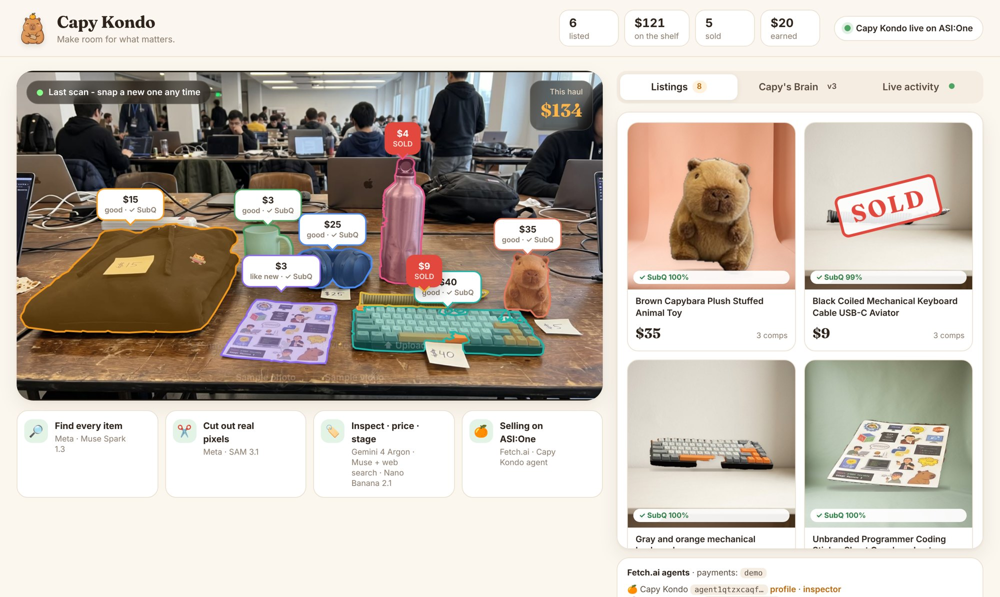

# Capy Kondo 🍊 — make room for what matters


**Point a camera at your clutter. A very chill capybara sells it for you.**

Capy Kondo turns one photo (or a short video) of the stuff you want to get rid of into honest, priced listings, then sells
them for you through a Fetch.ai agent that anyone can talk to on **ASI:One**. It also proves its own work and gets better
over time: every claim is checked against the real photo, and every correction becomes a lesson that is kept only if it
wins on held-out examples.

<p align="center"></p>

**▶ Demo video (2 min):** [docs/capykondo_demo.mp4](docs/capykondo_demo.mp4)

## What happens when you scan

| Step | What | Model |
|---|---|---|
| 1. Find | Every sellable item is named and boxed (price stickers are read too) | **Meta Muse Spark 1.3** |
| 2. Cut out | All items are segmented in **one** request; in video every item is tracked across frames | **Meta SAM 3.1** |
| 3. Real pixels | The listing photo is the item's real camera pixels (SAM mask); only the empty studio backdrop is generated | **Nano Banana 2.1** |
| 4. Inspect | Condition grade + visible flaws, from one or more views of the item | **Gemini 4 Argon** |
| 5. Price | Identification + live web search for comparable listings (cited) | **Muse Spark 1.3 + web search** |
| 6. Verify | Does the photo back up every claim? (item match, brand visible, condition, prohibited) Code acts on the probabilities: unverified brands are removed and re-priced, mismatches go to review, prohibited items are blocked | **SubQ Snap 1.1** (Subquadratic) |
| 7. Sell | Listings go live with the **Capy Kondo** agent on Agentverse / ASI:One | **Fetch.ai uAgents** |

A typical photo of ~8 items is fully listed in about a minute (Muse ≈ 10 s, SAM ≈ 2–5 s, then pricing/inspection/
verification run in parallel per item).

## Capy's Brain — a system that gets better (and can roll itself back)

- Every correction — from the seller (*"the mug should be $5"*) **or automatically from the SubQ verifier**
  (e.g. *"Sony" claimed, but no logo is visible*) — is stored as an evaluation case.
- **Gemini 4 Argon** (the coach) turns it into one general, reusable lesson.
- The lesson is evaluated **with vs. without** on the corrected case plus **held-out cases it has never seen**
  (earlier corrections + a starter benchmark). Identification answers are refereed by **SubQ Snap** in one batched
  decision call; prices and grades are scored by rules.
- It is **adopted only if it fixes the corrected case with zero held-out regressions**; otherwise it is **rolled back**.
- Every decision is a **git commit** in `data/brain` (`playbook.md`, `history.md`), and adopted lessons are injected into
  future prompts — so the next scan gets it right the first time.

## Selling on ASI:One (Fetch.ai)

Two agents built with **uAgents**, registered on **Agentverse**, discoverable and usable from **ASI:One**:

| Agent | Address | What it does |
|---|---|---|
| **Capy Kondo** (`capy-kondo`) | `agent1qtzxcaqfx88j4l0078ktkeat7lka3z9gvg7n0al4u6245zf9727xqgd3sj2` | Marketplace agent for buyers and sellers: search, item details with evidence, haggling, payment, seller corrections, "what have you learned?" |
| **Capy Appraiser** (`capy-appraiser`) | `agent1qgc834a4yf39tcshhupmxsft9vlw9mnanqyfdrwh5xqe5t8j2tvajuz8alk` | Specialist: photo/video link in → priced, verified listings out. Capy Kondo delegates to it over an agent-to-agent protocol |

- **Agent Chat Protocol** with **ASI:One Interactive Cards**: carousels of items, detail views with evidence (real photo,
  flaws, comps, SubQ verification), offer forms, counter-offer and purchase review cards, receipts.
- **Agent Payment Protocol** (seller role) with **Stripe Checkout** in test mode (`RequestPayment` → `CommitPayment` →
  `CompletePayment`). Without Stripe keys, purchases run in a clearly labelled demo mode.
- **Multi-agent**: `CapyAppraisalProtocol` (`AppraiseRequest` / `AppraiseResult`) between Capy Kondo and Capy Appraiser.
- **SubQ Snap decisions inside the agent**: long-context **shelf search** (the whole catalog scored against the buyer's
  words in one call: *"something to keep my drinks cold"* → the water bottle), **scam gating** (gift cards, codes,
  off-platform payment), and **negotiation strategy** as a probability distribution — while the seller's **floor price
  is enforced in code**.
- **ASI:One LLM** (`asi1-mini`) for small talk.
- **Monetization**: a per-sale fee through the Payment Protocol (and a monthly plan for shops/resellers) — every sale is
  an agent-to-agent transaction on Fetch's rails.

Try on ASI:One: *"Any headphones under $30?"*, *"Would you take $15 for the keyboard?"*, *"I want to sell my stuff:
<photo link>"*, *"The mug should be $5"*, *"What have you learned?"*

## Run it

Needs Python 3.11+ and `ffmpeg` (`brew install ffmpeg` / `apt install ffmpeg`).

```bash
python3 -m venv .venv && . .venv/bin/activate
pip install -r requirements.txt
cp .env.example .env      # fill in keys (see below)
python -m capykondo       # web app on http://localhost:8787 + both Fetch.ai agents
```

`.env` keys:

| Key | Needed for |
|---|---|
| `MODEL_API_KEY` | Meta Model API (Muse Spark, SAM 3.1) |
| `GEMINI_API_KEY` | Gemini 4 Argon, Nano Banana 2.1 |
| `SUBQ_API_KEY` | SubQ Snap 1.1 decisions |
| `ASI1_API_KEY` | ASI:One LLM (optional) |
| `BROKER_SEED`, `APPRAISER_SEED` | Agent identities — keep the same values to keep the same agent addresses |
| `AGENTVERSE_API_KEY` | Optional: connects both agent mailboxes to Agentverse automatically at startup |
| `STRIPE_SECRET_KEY`, `STRIPE_PUBLISHABLE_KEY` | Optional: Stripe test-mode payments (`sk_test_…`/`pk_test_…`) |
| `PUBLIC_BASE_URL` | Optional: public HTTPS URL of this server, for item photos inside ASI:One cards and phone-camera access |

**Connect the agents to Agentverse** (once): either set `AGENTVERSE_API_KEY`, or open the two inspector links printed at
startup (also shown in the app's sidebar) and click **Connect → Mailbox**. Then search for *Capy Kondo* on ASI:One or
open the agent's Agentverse profile and chat with it.

**Public URL** (so ASI:One can show item photos, and so a phone can use its camera on the scan page):

```bash
cloudflared tunnel --url http://localhost:8787
```

Put the printed `https://….trycloudflare.com` into `PUBLIC_BASE_URL` and restart.

### Live demo tips
- `http://localhost:8787` — scan anything: **Start camera → Snap photo** (or **Scan 6s video**), or use the samples.
- Click any card for the evidence drawer: real photo, flaws, SubQ verification, comps — and **Fix this listing** to teach
  Capy (watch **Capy's Brain** adopt or roll back the lesson).
- `python scripts/scan_cli.py photo.jpg` — run a scan from the terminal; `python scripts/test_broker.py` — scripted buyer.

## Repo map

```
capykondo/
  pipeline.py      photo/video -> items (Muse) -> masks/tracks (SAM) -> cutouts -> price/inspect/verify -> listings
  segment.py       SAM 3.1 output -> tracks, outlines, real-pixel cutouts
  studio.py        Nano Banana backdrops + compositing (item pixels untouched)
  subq.py          SubQ Snap decisions: trust check, shelf search, scam gate, negotiation, eval referee
  brain.py         corrections -> lessons -> held-out evaluation -> adopt/rollback (git-versioned playbook)
  commerce.py      search, negotiation (floor enforced in code), orders, payments
  agents/          Fetch.ai uAgents: broker (Capy Kondo), appraiser (Capy Appraiser), protocols, cards
  server.py        FastAPI app, SSE event stream, agent test console API
web/               demo UI (vanilla JS), agent test console, mascot art (Nano Banana 2.1)
demo/              demo video tooling (Playwright recording, ElevenLabs narration, ffmpeg assembly)
```

## Built with
Meta **Muse Spark 1.3** · Meta **SAM 3.1** · Google **Gemini 4 Argon** · Google **Nano Banana 2.1** ·
Subquadratic **SubQ Snap 1.1** · Fetch.ai **uAgents / Agentverse / ASI:One** (Chat Protocol, Interactive Cards, Payment
Protocol) · Stripe (test mode) · ElevenLabs (demo narration and music)
